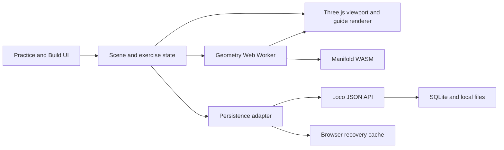

# Form Lab architecture proposal

Date: 23 October 2026. Status: recommended design; geometry and performance choices require prototyping.

The current browser-only prototype also supports [versioned share-link snapshots](impl_share-links.md). These encode forms and view in the URL fragment and need no Rust service or database. The backend below remains the future plan for named libraries, accounts and revision storage. Cloudflare deployment is a separate follow-up.

## Recommended stack and boundary

Use **Rust + Loco** for the service, **SQLite through SeaORM** for persistence, and **TypeScript + React + Three.js** for the interactive browser workspace. Build the frontend with Vite and serve its production assets from Loco. Browser-side geometry avoids a network round trip on each manipulation.

Loco provides Rails-like controllers, models, migrations, configuration and generators. Its current documentation also describes a React/Vite clientside setup, generated TypeScript types from Rust DTOs, and serving the built frontend from the backend. This aligns with the desired learning path. Verify and pin a compatible release when implementation begins; do not assume documentation on a moving branch exactly matches an installed release. [Loco overview](https://loco.rs/), [typed SPA guide](https://loco.rs/docs/how-to/build-a-spa/), [asset serving](https://loco.rs/docs/how-to/serve-assets/).

SQLite is suitable for a single-owner deployment and is supported by Loco configuration. There is no planned background work requiring Redis, a separate worker, or a database server. In-process background tasks, if introduced, are not durable jobs. [Database configuration source](https://github.com/loco-rs/loco/blob/master/website/src/content/docs/docs/reference/configuration.md).

React handles panels and application state. A small viewport module owns Three.js objects, picking, camera controls and rendering. Keep frame-by-frame updates outside React renders. Use an explicit command layer for edits and undo. A Rust frontend or custom GPU engine is not needed to learn Rust through this backend; either would add another substantial investigation before a useful practice tool exists.

## Geometry representation

The source of truth is a versioned parametric scene, not a serialized rendering mesh. Derived meshes and thumbnails are caches.

Each scene contains stable object IDs, named primitives, dimensions, transforms, deformation parameters, an ordered boolean tree, camera bookmarks, display settings and guide definitions. Store translation, a rotation quaternion and positive scale; expose degrees and friendly dimensions in the UI. Constrain invalid values, tiny dimensions and extreme scale ratios. Keep a documented axis convention and internal units.

Operations are typed nodes: `primitive`, `deform`, `union`, `difference`, and `intersection`. A simple UI may show a list, but nested results must have explicit operand order and references. Removing a referenced object must update or remove dependent operations as one undoable command. Do not silently leave broken links.

Separate visible reference layers:

1. Source objects and their editable parameters.
2. Derived solid geometry.
3. Construction guides attached to semantic features.
4. View-specific presentation and visibility.

This allows showing an original cylinder after it has become a cutter, and retaining a box's construction axes after a union. Guides on original operands are labeled separately from guides clipped to the resulting solid.

## Boolean operations

Prototype **Manifold's `manifold-3d` WASM package** as the primary solid-geometry engine. It is intended for manifold triangle meshes and provides a browser distribution. Its reliability claims concern valid solid inputs; our generators, deformations, conversions and line extraction still need validation. [Manifold](https://github.com/elalish/manifold), [WASM guide](https://manifoldcad.org/docs/jsapi/).

Evaluate `three-bvh-csg` only as a comparison/fallback candidate during the prototype. Its own README calls it experimental and documents numerical cases that may produce non-manifold output. It should not become the teaching reference merely because a demo is easy to assemble. [three-bvh-csg](https://github.com/gkjohnson/three-bvh-csg).

Run expensive operations in a Web Worker. During dragging, show the moving operands and either a throttled preview or the previous valid result with a visible “updating” state. On release, request the final result. Revision IDs ensure an old worker response cannot overwrite newer edits. Bound work, handle timeouts and allow worker restart.

Manifold objects require explicit disposal; JavaScript garbage collection does not automatically release them. Dispose intermediate WASM objects and GPU buffers after edits, undo history eviction and scene changes. [Memory-management guide](https://manifoldcad.org/docs/jsapi/documents/Using_Manifold.html).

Preserve source provenance through boolean evaluation where the selected engine permits it. The prototype must establish how to extract and join operand-intersection segments into clean curves, remove internal triangulation edges, and retain useful labels after repeated cuts. If this fails, restrict the initially supported pairs and use explicit pairwise intersection computation for those pairs. Do not replace the requested cut operation with a translucent overlap and call it complete.

Keep cases distinct: no overlap, face contact, edge/point tangency, containment, full subtraction and coincident geometry. Empty solids are valid operation results but usually poor generated exercises. Curved output is a controlled tessellation approximation, not exact analytic CAD geometry.

## Deformations and cross-contours

For early form manipulation, generate a tube or rectangular solid along a centerline, with sampled section size, orientation and taper. Use stable transported frames along the curve so sections do not unexpectedly flip near straight portions or inflections. Cross-contours derive from those sections and receive the same deformation as the surface. Their hidden parts must be classified against the geometry.

Support modest bend and radius variation first. Validate end caps, positive section sizes, continuity and self-intersection limits. High curvature relative to thickness can create invalid forms: constrain the control or show why the edit is unavailable. Arbitrary branched surfaces and freely sculpted boolean inputs need a later meshing strategy.

Primitive cross-sections and centerlines are generated explicitly. Avoid trying to infer teaching contours from an arbitrary triangulated mesh. A world-space section, a surface-following contour and an original object's guide have different meanings and should not share an ambiguous toggle.

## Rendering is a dedicated feature

The renderer must distinguish:

| Line type | Meaning | Proposed handling |
| --- | --- | --- |
| Silhouette | Boundary of the visible volume from the current camera | View-dependent outline extraction; compare screen-space and mesh-based approaches in the prototype |
| Hard edge | Real crease or intersection boundary | Feature/provenance edges, with irrelevant triangulation edges removed |
| Cross-contour | Selected section explaining the surface | Explicit parametric curves, clipped/occluded against the correct solid |
| Centerline/axis | Construction guide | Sparse, lighter style with clear semantics |
| Hidden segment | Part of a guide/edge behind a solid | Depth-based split or visibility classification, then muted/dashed styling |

Three.js `EdgesGeometry` selects edges using adjoining face-normal angles. From that definition, it cannot by itself supply all view-dependent silhouettes, pedagogical cross-contours or hidden-line styling; those require additional work. [EdgesGeometry documentation](https://threejs.org/docs/pages/EdgesGeometry.html).

Use a depth pass for visibility, with carefully tested bias to avoid flicker. Evaluate reliable screen-space line widths across browsers instead of relying on platform-specific wide native WebGL lines. Favor crisp black contours on a light background, lightly shaded or unshaded solids, and adjustable guide density. Monochrome line hierarchy must remain understandable without operand colors.

Export initially uses the same renderer at a larger fixed resolution for a faithful PNG. True vector SVG export requires robust projected paths and hidden-line clipping, so it is deferred rather than approximated as thousands of mesh triangles.

## Camera and editor controls

Use OrbitControls for view movement and TransformControls as a basis for object movement, rotation and scaling. Disable orbit while an object handle is dragged. Provide local/world-axis choice as an advanced setting and snapping as a visible option. The library supplies useful mechanics; the application must implement the simpler labeled interaction described in the PRD. [TransformControls](https://threejs.org/docs/pages/TransformControls.html), [official integration example](https://github.com/mrdoob/three.js/blob/dev/examples/misc_controls_transform.html).

Camera bookmarks store projection, position, orientation, target, field of view or orthographic scale, and reference aspect ratio. Use a fixed-aspect drawing frame or letterboxing when restoring on another device so the composition remains predictable. Keep interaction state such as hovered handles out of persisted scenes.

## Persistence and API

| Record | Proposed contents |
| --- | --- |
| Scene | ID, title, schema version, revision, validated scene document, timestamps and optional thumbnail |
| Exercise template | Versioned bundled definition: constraints, steps, reveal configuration and self-check prompts |
| Practice session | Template/version, seed, generator version, immutable resolved scene/camera, start/end and self-assessment |
| Preferences | Input/display defaults and last-used practice settings |

Start templates as version-controlled bundled JSON, not a lesson-authoring CMS. Store a whole scene document per revision rather than database rows for individual vertices. Keep Rust DTOs separate from ORM entities; generate frontend bindings where supported and validate imported JSON at runtime on both sides.

Proposed endpoints: scene list/create/read/update/delete; practice session create/complete/history; preferences read/update; bundled exercise catalog; liveness and readiness. Keep destructive operations explicit. Deletion has an undo or recoverable state at the product level where feasible.

Updates carry an expected revision. A stale save returns a conflict instead of silently overwriting a change from another tab. Debounced autosave shows saving/saved/error status and keeps the last local recovery draft in IndexedDB. Initially, offline recovery is per device; there is no claim of complete offline sync or conflict-free collaboration.

Imported documents have size, object-count, nesting-depth and numeric limits; reject cycles, invalid references, unsupported versions and external resource URLs. Scene documents are data only: they cannot contain executable scripts. Implement forward migrations for supported older formats and leave the original file intact on migration failure.

## Self-hosting

Default deployment: a multi-stage container build produces the Rust service plus bundled frontend/worker/WASM assets. Runtime needs one app container and a mounted `/data` directory for SQLite and local artifacts. Node and Rust toolchains are build dependencies, not runtime services. Loco documents release-binary and Docker deployment. [Deployment guide](https://loco.rs/docs/how-to/deploy/).

Bundle assets locally, including fonts or icons if used. No required SaaS, external CDN, analytics or AI API. Same-origin API calls simplify deployment. SQLite lives on local storage; any NAS network share suitability needs a separate check. Back up with a consistent SQLite backup or a stopped service, not an arbitrary live database-file copy that ignores WAL state. Verify restoration before calling the deployment complete.

Use one-owner authentication for network access, disable public registration and keep secrets outside source control. Prefer an HttpOnly cookie session/JWT with corresponding CSRF protection for mutations; do not assume the starter's auth/storage choices are the final product policy. TLS belongs at the user's reverse proxy for remote access. A deliberately unauthenticated development mode binds only to loopback. Host and port defaults must not accidentally expose the app publicly.

Provide readiness checks, explicit database migrations, versioned images and a documented restore-based rollback when a schema downgrade is unsupported. A stopped development server is not a self-hosting deliverable; verify the packaged release on a fresh deployment.

## Future in-app drawing and native app

Define boundaries now, implement adapters only when needed:

- `SceneDocument` and `ExerciseSession` are portable data structures, independent of browser globals and HTTP controllers.
- A persistence interface supports the Loco API today and a future local desktop storage implementation.
- A future 2D drawing layer stores strokes, pressure/time samples, layers and undo against an immutable exercise snapshot and locked projection. It must not confuse page-space strokes with curves attached to a rotating 3D surface.

Tauri is a plausible later shell for the same web interface and Rust domain logic; its documentation supports web frontends with Rust/native integrations. This is a reuse opportunity, not a promise that packaging automatically delivers good stylus behavior. Evaluate pen latency, pressure, palm rejection, WebGL/WASM compatibility and device-specific input before selecting native targets. [Tauri overview](https://v2.tauri.app/start/).

For a native version, prefer calling extracted Rust services through native commands where useful, rather than requiring a full local HTTP server. A desktop app that connects to the existing self-hosted service is another option. Choose based on offline requirements later; do not implement synchronization infrastructure speculatively.

## Learning Rust through the project

Start with a health endpoint and typed scene validation (`struct`, `enum`, `Option`, `Result`, Serde). Add CRUD with SeaORM and migrations, then request/model tests and error handling. Next, isolate exercise metadata/validation into ordinary Rust modules so domain logic stays independent of Loco. Finally learn release builds, configuration and deployment. Browser geometry can move into Rust/WASM later if profiling or code sharing justifies it; that rewrite is not part of the first release.
